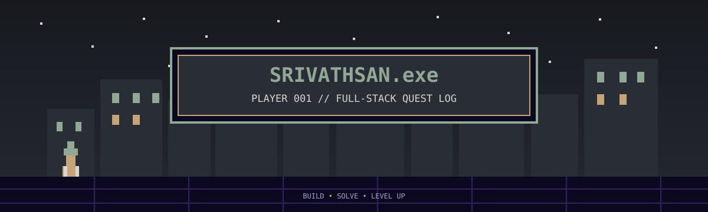

<div align="center">




# SRIVATHSAN0804

### `SOFTWARE ENGINEER IN PROGRESS`

*Building things, solving problems, and learning how systems work.*

[](https://github.com/srivathsan0804)
[](https://www.linkedin.com/)
[](https://leetcode.com/)
[](https://www.youtube.com/)

`CHENNAI, INDIA` · `CSE '27` · `CGPA 8.44`

</div>

---

## ▣ 01 — PLAYER STATUS

```text
┌────────────────────────────────────────────────┐
│  PLAYER PROFILE                                │
├────────────────────────────────────────────────┤
│  NAME       Srivathsan K. M.                   │
│  CLASS      Computer Science & Engineering     │
│  LOCATION   Chennai, India                     │
│  QUEST      Become a better software engineer  │
│  SPECIALTY  DSA · Full Stack · Backend · AI    │
└────────────────────────────────────────────────┘
```

I'm pursuing a B.E. in Computer Science and Engineering at **Easwari Engineering College**, graduating in 2027.

I enjoy solving algorithmic problems, building full-stack applications, and understanding how software systems work under the hood. I like projects that combine practical engineering with thoughtful problem-solving.

- 🎓 B.E. Computer Science and Engineering
- 📊 CGPA: **8.44 / 10**
- 🧠 Data structures, algorithms, and core computer science
- 🛠️ Full-stack development and open-source contributions

---

## ▣ 02 — TECH INVENTORY

### Languages


### Frontend & Mobile


### Backend & APIs


### Databases & Tools


### AI & Integrations


---

## ▣ 03 — QUEST LOG / FEATURED BUILDS

<table>
<tr>
<td width="50%" valign="top">

### `QUEST 001`
## Arena Code Battle

**Real-time competitive coding platform**

A multiplayer coding platform built around real-time matchmaking, code execution, and ranked gameplay.

- WebSocket-powered matchmaking
- ELO-based ratings and arena tiers
- Code execution through JDoodle API
- Persistent player and competition data

**Stack**

`React` `Node.js` `Socket.IO` `PostgreSQL` `Neon`

</td>
<td width="50%" valign="top">

### `QUEST 002`
## QuickFix

**AI-powered service marketplace**

A full-stack marketplace connecting customers with service providers using AI-assisted job creation and location-aware features.

- Photo-to-service-request pipeline
- Blind bidding for providers
- SkillGraph progression and gamification
- Location-aware features and SOS support

**Stack**

`FastAPI` `PostgreSQL` `SQLAlchemy` `Gemini AI` `LocationIQ`

</td>
</tr>
<tr>
<td colspan="2" valign="top">

### `QUEST 003` — SafeCampus

**Campus safety and location-aware assistance**

A mobile application focused on safer campus navigation and emergency communication.

- Safe-zone routing using geographic distance calculations
- Emergency broadcasts and live-location sharing
- Administrative monitoring dashboard
- Mobile-first experience built with Expo

**Stack**

`React Native` `Expo` `Firebase` `Expo Location`

</td>
</tr>
</table>

---

## ▣ 04 — OPEN-SOURCE GUILD

### Excalidraw — Recent Colors Palette

[**View contribution · PR #11700**](https://github.com/excalidraw/excalidraw/pull/11700)

Contributed to a recent-colors palette feature for the shape-properties color picker.

- Maintains a history of recently used colors
- Filters duplicate colors
- Limits the palette to five colors
- Uses persistent local storage

`React` `TypeScript` `LocalStorage`

---

## ▣ 05 — ACHIEVEMENT ROOM

<div align="center">


</div>

- Solved **800+ LeetCode problems**
- Reached a contest rating of approximately **1500**
- Earned the **500 Days Badge**
- Regularly practice algorithms, data structures, and problem-solving patterns

---

## ▣ 06 — CERTIFICATION SHELF

```text
┌──────────────────────────────────────────────┐
│  CERTIFICATION INVENTORY                     │
├──────────────────────────────────────────────┤
│  [01] AWS Certified Cloud Practitioner       │
│  [02] Cisco Networking Essentials            │
└──────────────────────────────────────────────┘
```

---

## ▣ 07 — CREATOR CORNER

I share data structures and algorithms content through **CodeClub0804**.

[](https://www.youtube.com/)

---

## ▣ 08 — ACTIVE QUESTS

```text
┌────────────────────────────────────────────────┐
│  CURRENT OBJECTIVES                            │
├────────────────────────────────────────────────┤
│  [*] Sharpen DSA and problem-solving            │
│  [*] Deepen core CS fundamentals                │
│  [*] Build reliable, practical software         │
│  [*] Explore backend engineering and design     │
│  [*] Contribute to open-source projects         │
└────────────────────────────────────────────────┘
```

---

<div align="center">

**`THANKS FOR VISITING MY CORNER OF THE INTERNET`**

*Keep learning. Keep building. Keep shipping.*


</div>
